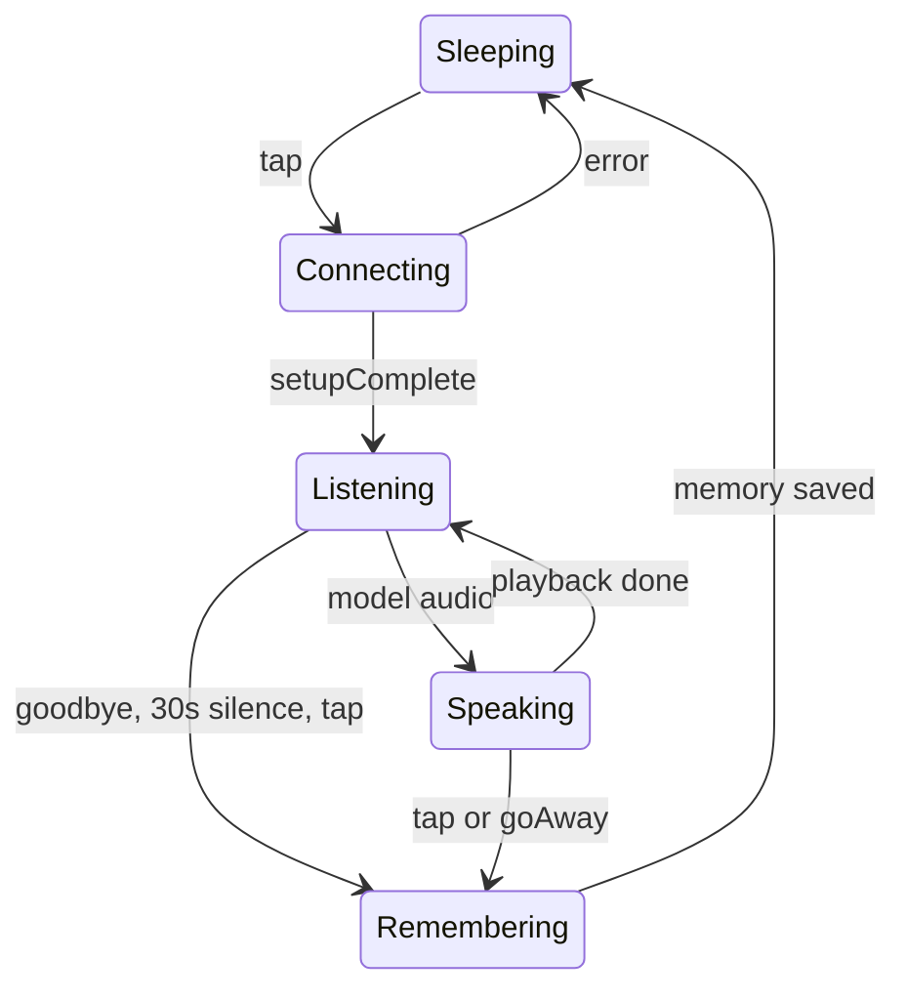
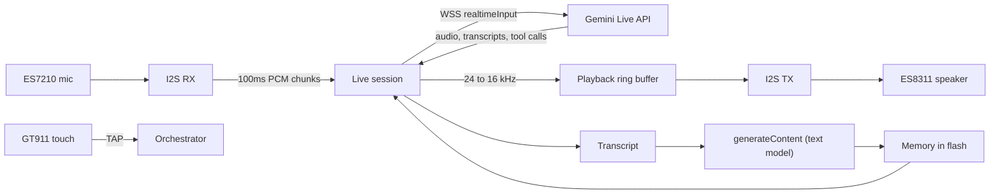

# Gemini Live companion for the ESP32-S3-BOX-3

A small voice companion for the **ESP32-S3-BOX-3**, written in Rust `no_std` with [esp-hal](https://github.com/esp-rs/esp-hal). Inspired by [moody-box](https://github.com/bjoernQ/moody-box), but it holds real-time conversations through the [Gemini Live API](https://ai.google.dev/gemini-api/docs/live-guide) and remembers what you talked about.

- While unused, the display shows a **snoozing face**: closed eyes that slowly breathe while "Z"s drift up.
- **Tap the display** to wake it up. The robot greets you and the conversation starts.
- During the conversation, animated **robot eyes** look around while listening, bounce along while speaking and change their expression when the model calls the `set_mood` tool.
- When the conversation ends, the transcript is **distilled into a memory** and stored in flash. The next conversation starts with that memory, so the robot can refer to things you told it and ask how they went.

## Conversation flow



A conversation ends when any of the following happens:
- the model calls `end_conversation` (it's told to do so after saying goodbye)
- nobody speaks for 30 seconds
- you tap the display
- the server sends `goAway`, or the session approaches the roughly 15 minute limit for audio-only sessions

## Hardware

| Component | Details |
|-----------|---------|
| Board | [ESP32-S3-BOX-3](https://github.com/espressif/esp-box) (16 MB flash, 8 MB PSRAM) |
| Display | 2.4" ILI9341, 320×240, SPI |
| Touch | GT911 on the shared I2C bus (GPIO8/GPIO18) |
| Audio in | ES7210 ADC (microphones) |
| Audio out | ES8311 DAC + speaker |
| Network | On-board Wi-Fi |

## Architecture

The firmware uses both CPU cores, like moody-box:

| Core | Responsibility |
|------|----------------|
| **PRO CPU** | Embassy runtime: Wi-Fi, TLS, the Live API WebSocket, I2S audio, touch polling, memory distillation |
| **APP CPU** | Display loop: snooze animation, RoboEyes, scanline effect, SPI DMA flush |



### Modules

| Module | Purpose |
|--------|---------|
| [`app`](src/app.rs) | Conversation state, signals between tasks, playback ring buffer |
| [`audio`](src/audio.rs) | Codec setup, mic streaming with half-duplex gating, speech playback |
| [`live`](src/live.rs) | Live API session: setup, persona and memory, tools, transcript, end detection |
| [`ws`](src/ws.rs) | Minimal WebSocket client (handshake, masking, fragmentation, ping/pong) |
| [`tls`](src/tls.rs) | TCP + [embedded-tls](https://crates.io/crates/embedded-tls) with a split reader/writer socket for full duplex |
| [`distill`](src/distill.rs) | Turns old memory plus transcript into updated memory (REST `generateContent`) |
| [`memory`](src/memory.rs) | Stores the memory as a checksummed record in the `nvs` partition |
| [`touch`](src/touch.rs) | GT911 polling, debounced tap signal |
| [`ui`](src/ui.rs) | Display loop, snooze face, eye behaviour per state |
| [`roboeyes`](src/roboeyes.rs), [`spi_dma_displayinterface`](src/spi_dma_displayinterface.rs), [`net`](src/net.rs) | Taken from moody-box |

### Implementation notes

- **Live API.** The firmware opens `wss://generativelanguage.googleapis.com/ws/...BidiGenerateContent` with `gemini-3.8-live`, `AUDIO` responses and input/output transcription. After `setupComplete` it sends a short `realtimeInput.text` nudge (including the server's `Date` header), so the model greets you first.
- **Audio.** The codecs run at 16 kHz. esp-hal derives MCLK as 256 × fs, and the ES7210 can't do 24 kHz at that clock ratio. Mic audio is sent as `audio/pcm;rate=16000`, which is the API's native input rate. The model's 24 kHz output is resampled to 16 kHz (3 samples in, 2 out, lightly smoothed) before playback.
- **Echo handling.** The box has no acoustic echo cancellation. While the model is speaking, and for 500 ms afterwards, the mic stream is replaced with silence, so the model can't hear itself and barge in. To interrupt the robot, tap the display. This also ends the conversation.
- **Memory.** After each conversation in which you said something, the old memory and the end of the transcript are sent to `gemini-3.1-flash-lite-preview`. The model returns an updated memory: bullet points of at most about 1500 characters, covering the last conversation date, facts about you, upcoming plans with absolute dates, and a "Follow up" list. The memory is written to the start of the `nvs` partition, which ESP-IDF's NVS library would normally use but this firmware doesn't. If distillation fails, the previous memory is kept.

## Prerequisites

1. **Rust ESP toolchain**, installed via [espup](https://github.com/esp-rs/espup). [`rust-toolchain.toml`](rust-toolchain.toml) currently pins `esp-1.97`, because the `esp` toolchain from 2026-11-16 fails to link (`l32r: literal placed after use` in `__pre_init`). If you don't have a toolchain with that name, install one or change the channel.
2. **espflash**: `cargo install espflash`
3. A **Google Gemini API key** from [Google AI Studio](https://aistudio.google.com/apikey).
4. A Wi-Fi network the board can join.

## Configuration

Credentials are compiled in via `env!()`. Set them in [`.cargo/config.toml`](.cargo/config.toml) under `[env]`, or export them in your shell (shell values take precedence):

```toml
[env]
SSID = "your-wifi-ssid"
PASSWORD = "your-wifi-password"
GEMINI_API_KEY = "your-gemini-api-key"
```

Don't commit real credentials.

The companion speaks German with the female voice `Aoede`. To change the persona, language, voice or model, edit the constants and `setup_message` in [`src/live.rs`](src/live.rs). The memory language is set in the prompt in [`src/distill.rs`](src/distill.rs).

## Build and flash

```bash
cargo run --release
```

This flashes with the runner from `.cargo/config.toml` (`espflash flash --monitor`). During boot the display shows a log console. Once Wi-Fi is up, it switches to the snoozing face.

The serial monitor prints the transcript and the new memory after each conversation. To make the robot forget everything, erase the memory with `espflash erase-region 0x9000 0x6000` (the `nvs` partition of the default partition table).

## Security and privacy

This is a hobby demo, not hardened firmware:

- **Compile-time secrets.** The Wi-Fi password and the Gemini API key are embedded in the flash image. Use a dedicated API key with usage limits.
- **TLS certificates are not verified.** Both Live API and REST connections use `embedded_tls::NoVerify`. Traffic is encrypted but not authenticated.
- **Voice and memory leave the device.** Your voice is streamed to Google while a conversation is active, and transcripts plus the stored memory are sent to Gemini to update the memory. The memory is stored unencrypted in flash.

## Third-party components

| Component | Source | License |
|-----------|--------|---------|
| RoboEyes eye animation | [FluxGarage/RoboEyes](https://github.com/FluxGarage/RoboEyes), via the Rust port in [moody-box](https://github.com/bjoernQ/moody-box) | GPL-3.0 |
| Display interface, Wi-Fi task, audio setup | [moody-box](https://github.com/bjoernQ/moody-box) | GPL-3.0-or-later |

## License

This project is licensed under the [GNU General Public License v3.0 or later](LICENSE), because it includes the GPL RoboEyes port.
